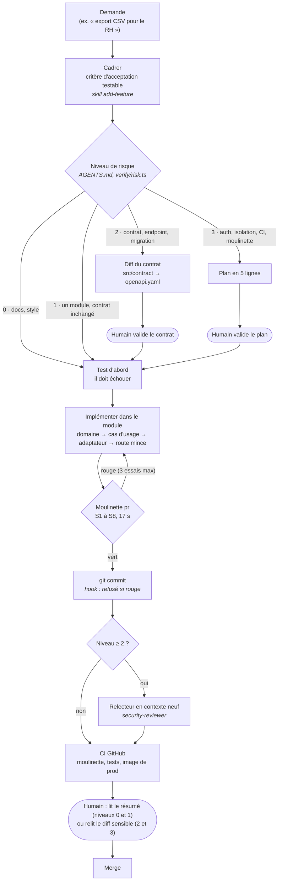

# Workflow piloté par le risque

Comment une demande devient un commit, et où l'humain intervient. Les **guides** orientent l'agent avant qu'il agisse
(`AGENTS.md`, skills) ; les **capteurs** vérifient après (moulinette, hooks, CI, relecteurs).

## Les capteurs, et le risque que chacun couvre

| Contrôle | Risque couvert | Bloquant |
| --- | --- | --- |
| S1 Types et lint | Code qui ne compile pas, erreurs évidentes | oui |
| S2 Règles d'architecture | Domaine qui dépend de l'infrastructure, module qui contourne l'API d'un autre | oui |
| S3 Secrets (gitleaks) | Secret écrit dans le code | oui |
| S4 Code mort et duplication | Dette qui grossit (seuils en cliquet : ils ne font que baisser) | oui |
| S5 Contrat OpenAPI | Contrat qui dérive du code, ou spec invalide | oui |
| S6 Sécurité statique (Semgrep, 8 règles maison) | Injection, stacktrace exposée, route sans contrôle d'accès | oui |
| S7 Dockerfile (hadolint) | Image non conforme (root, versions non épinglées) | oui |
| S8 Niveau de risque | Changement sensible qui passerait sans la relecture prévue | non (informe) |
| Tests d'API (69) | Contrat cassé, faille d'autorisation qui revient | oui (CI) |
| Image de production | App qui marche en dev mais pas en conteneur | oui (CI) |

## Où l'humain décide (et pourquoi pas ailleurs)

| Niveau | Exemple | Ce que fait l'humain | Coût |
| --- | --- | --- | --- |
| 0 | Corriger un texte d'UI | Rien en direct | 0 min |
| 1 | Nouvelle règle de validation dans un module | Lit le résumé de la moulinette et du commit | 1 min |
| 2 | Nouvel endpoint d'export | Valide le diff du contrat avant le code | 5 min |
| 3 | Changer une règle d'accès | Valide le plan, relit le diff sensible | 15 min |

Vitesse là où l'erreur est réversible et détectée par les capteurs ; sûreté là où elle coûterait cher (fuite entre
entreprises, contrat cassé pour les clients).
